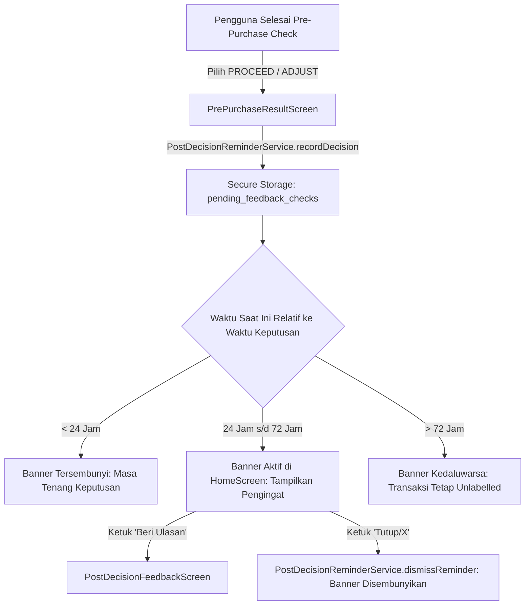

# Laporan Implementasi Tugas F5: Pemicu Konfirmasi Pasca-Keputusan

## 1. Ringkasan Eksekutif
Dalam kerangka penelitian *"Pengembangan Sistem Peringatan Dini Pengeluaran Tidak Terencana melalui Intervensi Pra-Pembelian Berbasis Pola Transaksi Personal"*, validasi label *ground-truth* (apakah suatu transaksi yang diperingatkan benar-benar terealisasi dan apakah transaksi tersebut sesuai rencana atau tidak terencana) memerlukan mekanisme umpan balik pasca-keputusan.

Tugas F5 mengimplementasikan mekanisme pemicu pengingat (*post-decision reminder*) pada aplikasi mobile dengan batasan teknis tidak menggunakan push notification pihak ketiga (`flutter_local_notifications`), melainkan menggunakan **spanduk dalam aplikasi (*in-app banner*)** yang terintegrasi di Beranda (*Home Screen*). Pengingat aktif dalam jendela temporal **24 jam hingga 72 jam** setelah pengguna mengambil keputusan pra-pembelian (`PROCEED` atau `ADJUST`).

---

## 2. Arsitektur & Mekanisme Pengingat

### 2.1 Alur Perekaman dan Jendela Waktu (24 Jam - 72 Jam)


### 2.2 Penanganan Pengguna yang Mengabaikan Pengingat (*Dismiss / Non-Response*)
Sesuai metodologi pilot penelitian:
1. Pengguna dapat menutup spanduk pengingat dengan menekan tombol **(X)**.
2. Aksi ini memanggil `PostDecisionReminderService.dismissReminder(checkId)` yang memperbarui flag `dismissed: true`.
3. Pengingat tidak akan muncul kembali di Beranda, dan sistem **tidak melemparkan error** atau memaksakan isian data.
4. Record pemeriksaan pra-pembelian di database backend tetap berstatus unlabelled (`feedback_submitted: false`, `was_impulsive: null`), sehingga data tersebut tidak mengotori dataset pelatihan lanjutan dengan asumsi keliru.

### 2.3 Ketahanan Jaringan pada Formulir Konfirmasi (*Network Resilience*)
Pada `PostDecisionFeedbackScreen`:
- Jika pengiriman feedback gagal akibat gangguan konektivitas, state jawaban formulir (status realisasi belanja, kesesuaian rencana, rating kepuasan, dan catatan) **tetap dipertahankan** pada form.
- Ditampilkan pesan kesalahan mengambang (*SnackBar*) dengan opsi mencoba kembali tanpa harus mengetik ulang informasi.
- Ketika berhasil terkirim, `PostDecisionReminderService.markSubmitted(checkId)` dipanggil secara asinkron untuk membersihkan antrean pengingat secara permanen.

### 2.4 Terminologi UI/UX
Mengacu pada perbaikan terminologi skripsi (bebas dari kesan menuduh/peyoratif):
- Label opsi realisasi: **"Sesuai Rencana"** (`was_impulsive = false`) vs **"Tidak Terencana"** (`was_impulsive = true`).
- Kolom database tetap kompatibel dengan skema SQL `pre_purchase_checks.was_impulsive`.

---

## 3. Berkas yang Diimplementasikan & Dimodifikasi

1. **`mobile/lib/features/pre_purchase/services/post_decision_reminder_service.dart` (Baru)**:
   - Model `PendingFeedbackCheck` dengan serialisasi JSON.
   - Fungsi penentu jendela `isWithinReminderWindow(decidedAt, now)`.
   - Penyimpanan lokal aman via `FlutterSecureStorage` dan fallback `inMemoryOverride` untuk pengujian deterministik.
   - Manajemen siklus hidup: `recordDecision()`, `getActiveReminder()`, `dismissReminder()`, dan `markSubmitted()`.
2. **`mobile/lib/features/pre_purchase/screens/pre_purchase_result_screen.dart` (Modifikasi)**:
   - Merekam item belanja dan `checkId` ke antrean pengingat ketika pengguna memilih tindakan `PROCEED` atau `ADJUST`.
3. **`mobile/lib/core/router/app_router.dart` (Modifikasi)**:
   - Meneruskan `checkId` dari query params atau state extra ke `PrePurchaseResultScreen`.
4. **`mobile/lib/features/home/screens/home_screen.dart` (Modifikasi)**:
   - Dikonversi menjadi `StatefulWidget` dengan `_loadActiveReminder()`.
   - Menampilkan `_buildReminderBanner()` berupa kartu amber dengan info belanja, batas waktu konfirmasi, tombol navigasi langsung ke form umpan balik, dan tombol dismiss `(X)`.
5. **`mobile/lib/features/pre_purchase/screens/post_decision_feedback_screen.dart` (Modifikasi)**:
   - Mengganti teks label menjadi terminologi netral "Sesuai Rencana" vs "Tidak Terencana".
   - Menambahkan integrasi `PostDecisionReminderService.markSubmitted(widget.checkId)`.
   - Mengamankan pemanggilan `BuildContext` pasca-gap asinkron (`if (!mounted) return;`).
6. **`mobile/test/features/pre_purchase/post_decision_reminder_test.dart` (Baru)**:
   - 9 pengujian unit yang memverifikasi seluruh skenario waktu, dismiss, dan integrasi status.

---

## 4. Hasil Verifikasi & Pengujian

### 4.1 Unit Testing Mobile (`flutter test`)
Perintah eksekusi:
```bash
flutter test test/features/pre_purchase/post_decision_reminder_test.dart
```
Hasil:
- `PostDecisionReminderService - Window Logic Waktu < 24 jam belum memicu pengingat`: **PASSED**
- `PostDecisionReminderService - Window Logic Tepat 24 jam memicu pengingat`: **PASSED**
- `PostDecisionReminderService - Window Logic Di antara 24 jam dan 72 jam memicu pengingat`: **PASSED**
- `PostDecisionReminderService - Window Logic Tepat 72 jam memicu pengingat`: **PASSED**
- `PostDecisionReminderService - Window Logic Lebih dari 72 jam tidak lagi memicu pengingat (jendela kedaluwarsa)`: **PASSED**
- `PostDecisionReminderService - Workflow State Perekaman keputusan PROCEED dan retrieval reminder sesuai jendela`: **PASSED**
- `PostDecisionReminderService - Workflow State Pengguna mengabaikan banner (dismiss) menyembunyikan pengingat tanpa error`: **PASSED**
- `PostDecisionReminderService - Workflow State Pengguna menyelesaikan konfirmasi (submitted) menyembunyikan pengingat`: **PASSED**
- `PostDecisionReminderService - Workflow State Dua item: hanya item yang memenuhi kriteria jendela yang diambil`: **PASSED**
- **Ringkasan:** 9 dari 9 tes lulus (100%).

### 4.2 Analisis Kode Statis (`flutter analyze`)
Perintah eksekusi:
```bash
flutter analyze
```
Hasil:
```
Analyzing mobile...
No issues found! (ran in 2.2s)
```

### 4.3 Regresi Pengujian Backend
Perintah eksekusi:
```bash
venv\Scripts\python.exe -m unittest discover -s tests -p "test_*.py" -v
```
Hasil:
- `test_admin_auth`: 6 tes **PASSED**
- `test_persistence`: 6 tes **PASSED**
- `test_user_stats`: 7 tes **PASSED**
- `test_consent`: 4 tes **PASSED**
- **Ringkasan:** 23 dari 23 tes backend lulus (100%).
