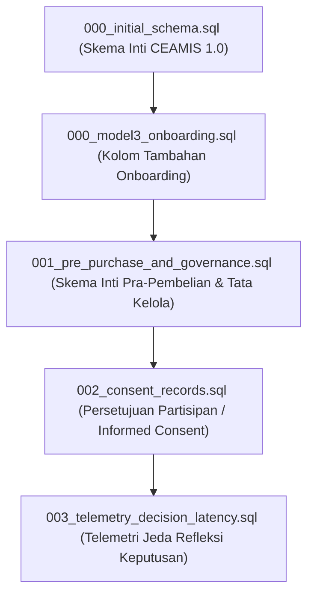

# Panduan Langkah Manual Kesiapan Uji Coba Lapangan (Field Pilot)

Dokumen ini disusun sebagai panduan operasional teknis yang harus dijalankan sebelum pelaksanaan *field pilot* CEAMIS 2.0. Seluruh langkah didasarkan pada pembuktian kode sumber dan arsitektur repositori aktif. Dokumen ini bersifat panduan konfigurasi manual dan tidak mengeksekusi perintah ke basis data produksi.

---

## 1. Urutan Migrasi SQL Supabase

Seluruh migrasi basis data dijalankan pada dashboard Supabase (**SQL Editor → New Query**) secara berurutan dari `000` hingga `003`.



### Rincian Analisis Setiap Berkas Migrasi:

| Urutan | Nama Berkas | Isi dan Entitas yang Dibuat | Idempotensi | Keamanan pada Basis Data Berisi Tabel Lama |
|:---|:---|:---|:---|:---|
| **1** | `backend/db/migrations/000_initial_schema.sql` | Tabel inti CEAMIS: `user_profiles`, `transactions`, `onboarding_data`, `warnings`, `debt_records`, `planning`. Trigger `handle_new_user` pada `auth.users`, trigger streak transaksi, serta kebijakan dasar RLS. | **Sebagian** (*Partially Idempotent*). Tabel memakai `CREATE TABLE IF NOT EXISTS`, fungsi memakai `CREATE OR REPLACE FUNCTION`. Namun, `CREATE POLICY` dan sebagian pemicu (*trigger*) tidak memiliki klausa `DROP IF EXISTS`. | **Aman untuk DB baru**. Jika dijalankan pada basis data yang sudah memiliki tabel dan kebijakan lama, akan muncul galat (*error*) `policy already exists`. |
| **2** | `backend/db/migrations/000_model3_onboarding.sql` | Penambahan 6 kolom parameter Model 3 pada tabel `onboarding_data`: `tanggungan_keluarga`, `city_tier_enc`, `toleransi_rugi_enc`, `save_habit`, `punya_tabungan`, `jumlah_tabungan_bulan`. | **Penuh** (*Fully Idempotent*). Menggunakan `ALTER TABLE ... ADD COLUMN IF NOT EXISTS` dengan nilai default eksplisit. | **Sangat Aman**. Tidak merusak atau menghapus data yang telah tersimpan sebelumnya pada tabel `onboarding_data`. |
| **3** | `backend/db/migrations/001_pre_purchase_and_governance.sql` | Entitas CEAMIS 2.0: `model_versions`, `pre_purchase_checks`, `risk_predictions`, `post_decision_feedbacks`, `audit_logs`. Dilengkapi indeks performa dan RLS granular per peran. | **Penuh** (*Fully Idempotent*). Seluruh tabel dan indeks memakai `IF NOT EXISTS`. Seluruh kebijakan RLS didahului `DROP POLICY IF EXISTS`. | **Sangat Aman**. Membangun tabel-tabel baru tanpa memodifikasi struktur tabel keuangan legacy. |
| **4** | `backend/db/migrations/002_consent_records.sql` | Tabel `consent_records` untuk riwayat persetujuan etik (*informed consent*) partisipan pilot, indeks pencarian status aktif, serta 4 kebijakan RLS (termasuk akses audit admin). | **Penuh** (*Fully Idempotent*). Tabel dan indeks memakai `IF NOT EXISTS`, seluruh kebijakan RLS didahului `DROP POLICY IF EXISTS`. | **Sangat Aman**. Tabel berdiri sendiri dan terikat Foreign Key langsung ke `auth.users(id)`. |
| **5** | `backend/db/migrations/003_telemetry_decision_latency.sql` | Penambahan kolom `decision_latency_ms` pada tabel `pre_purchase_checks` dan indeks parsial untuk analisis telemetri keputusan berizin etik. | **Penuh** (*Fully Idempotent*). Menggunakan `ALTER TABLE ... ADD COLUMN IF NOT EXISTS` dan `CREATE INDEX IF NOT EXISTS`. | **Sangat Aman**. Penambahan kolom bersifat nullable sehingga tidak mengganggu integritas rekaman yang sudah ada. |

---

## 2. Variabel Lingkungan Wajib per Komponen (Tanpa Nilai)

Untuk menjaga kerahasiaan dan keamanan sistem, daftar berikut hanya mencantumkan nama variabel lingkungan tanpa nilai rahasia apa pun.

### A. Komponen Backend (`backend/.env`)
- `PORT`
- `PERSISTENCE_BACKEND` *(Ubah dari bawaan 'memory' menjadi 'db' sebelum pilot)*
- `SUPABASE_URL`
- `SUPABASE_SERVICE_ROLE_KEY`
- `SUPABASE_JWT_SECRET`
- `RESEARCH_PSEUDONYMIZATION_SALT` *(Wajib diatur dengan string acak berkekuatan tinggi)*
- `GEMINI_API_KEY`
- `GROQ_API_KEY`
- `PRIMARY_LLM`
- `MAX_OUTPUT_TOKENS`
- `LLM_TEMPERATURE`
- `MAX_HISTORY_MESSAGES`
- `LLM_ENABLED`
- `LLM_OCR_ENABLED`
- `LLM_INSIGHT_ENABLED`
- `LLM_EDUCATION_ENABLED`
- `ONBOARDING_MODELS_ENABLED`
- `MODEL_PATH`

### B. Komponen Frontend Web Admin (`frontend/.env.local`)
- `NEXT_PUBLIC_SUPABASE_URL`
- `NEXT_PUBLIC_SUPABASE_ANON_KEY`
- `NEXT_PUBLIC_BACKEND_URL`
- `NEXT_PUBLIC_AI_SERVICE_URL`
- `DATABASE_URL`

### C. Komponen Aplikasi Bergerak Pengguna (`mobile/.env`)
- `API_BASE_URL`
- `AI_SERVICE_URL`
- `SUPABASE_URL`
- `SUPABASE_ANON_KEY`

---

## 3. Prosedur Pemberian Peran Admin (*Admin Role Provisioning*)

Pemberian hak akses administrator pada suatu akun pengguna dilakukan langsung melalui Supabase Auth dengan memanfaatkan klaim metadata terproteksi.

### Langkah Operasional:
1. Pengguna target mendaftar akun seperti biasa melalui aplikasi.
2. Administrator membuka dashboard Supabase: **SQL Editor → New Query**.
3. Jalankan kueri SQL dari berkas `backend/scripts/set_admin_role.sql` dengan mengganti alamat email:
   ```sql
   UPDATE auth.users
   SET raw_app_meta_data = coalesce(raw_app_meta_data, '{}'::jsonb) || '{"role": "admin"}'::jsonb,
       raw_user_meta_data = coalesce(raw_user_meta_data, '{}'::jsonb) || '{"role": "admin"}'::jsonb
   WHERE email = '<alamat_email_admin_target>';
   ```
4. Verifikasi keberhasilan peran melalui kueri:
   ```sql
   SELECT id, email, raw_app_meta_data->>'role' AS app_role, raw_user_meta_data->>'role' AS user_role, updated_at
   FROM auth.users
   WHERE email = '<alamat_email_admin_target>';
   ```
5. **Mekanisme Validasi Kode:**
   Pada sisi backend (`backend/app/utils/auth.py` baris 78-102), dependensi `verify_admin_role` memeriksa payload token JWT yang dikirimkan. Backend membaca klaim `app_metadata.role` (prioritas utama yang aman dari manipulasi klien) dan menolak permintaan dengan status `403 Forbidden` jika nilai klaim bukan `'admin'`.

---

## 4. Lokasi dan Pengisian Teks Persetujuan Partisipan (*Informed Consent*)

Sebelum aplikasi didistribusikan ke partisipan pilot, teks persetujuan resmi wajib disesuaikan dengan protokol komite etik penelitian.

- **Lokasi Berkas:** `mobile/lib/core/constants/consent_text.dart`
- **Daftar Penanda yang Harus Diisi:**
  1. `researchTitle`: Ganti penanda `[ISI SESUAI LEMBAR INFORMASI PENELITIAN]` dengan judul formal penelitian tesis yang disahkan.
  2. `researchPurpose`: Ganti penanda `[ISI SESUAI LEMBAR INFORMASI PENELITIAN]` dengan rumusan tujuan penelitian resmi.
  3. `dataCollected`: Isi rincian mekanisme perlindungan dan standar keamanan data pada penanda `[ISI SESUAI LEMBAR INFORMASI PENELITIAN]`.
  4. `thirdPartyProcessing`: Verifikasi klausul transparansi pemrosesan pihak ketiga (Google Gemini API) untuk fitur ekstraksi teks struk belanja dan materi edukasi.
  5. `withdrawalRights`: Verifikasi klausul hak penarikan persetujuan partisipan tanpa sanksi.
  6. `researcherContact`: Isi penanda kontak resmi:
     - `[NAMA PENELITI]`: Nama lengkap peneliti utama.
     - `[SURAT ELEKTRONIK PENELITI]`: Alamat surel institusional peneliti.
     - `[NAMA DOSEN PEMBIMBING]`: Nama lengkap dosen pembimbing tugas akhir / tesis.

---

## 5. Pengujian Wajib pada Basis Data Riil (*Real Database Validation*)

Karena seluruh pengujian unit otomatis sejauh ini menggunakan repositori memori (*mock/in-memory*), pengujian berikut wajib dilakukan pada instans PostgreSQL Supabase hidup sebelum peluncuran pilot:

1. **Uji Kebijakan Row-Level Security (RLS):**
   - Lakukan login sebagai Partisipan A dan Partisipan B.
   - Pastikan Partisipan A tidak dapat membaca rekaman tabel `pre_purchase_checks`, `risk_predictions`, `post_decision_feedbacks`, dan `consent_records` milik Partisipan B melalui REST API Supabase.
   - Pastikan pengguna non-admin menerima penolakan saat mencoba mengakses tabel `audit_logs` atau memodifikasi tabel `model_versions`.
2. **Uji Mode Persistensi Basis Data (`PERSISTENCE_BACKEND="db"`):**
   - Uji alur penyimpanan transaksi dan evaluasi pra-pembelian end-to-end dengan koneksi PostgreSQL aktif.
   - Pastikan kolom berformat JSONB (`features_snapshot` dan `trigger_factors`) tersimpan secara terstruktur dan dapat dibaca kembali tanpa kesalahan tipe data (*type mismatch*).
3. **Uji Alur Persetujuan Etik (*Consent Lifecycle*):**
   - Registrasi pengguna baru dan verifikasi pembentukan rekaman pada tabel `consent_records` dengan nilai `given=TRUE`.
   - Lakukan penarikan izin melalui menu profil aplikasi seluler dan pastikan kolom `given=FALSE` serta `withdrawn_at` terisi dengan waktu yang valid.
   - Pastikan telemetri jeda waktu refleksi (`decision_latency_ms`) bernilai `NULL` untuk pengguna yang tidak memberikan izin.
4. **Uji Skrip Ekspor Pseudonim (`backend/scripts/export_pilot_data.py`):**
   - Jalankan skrip ekspor terhadap basis data nyata menggunakan salt riil:
     ```bash
     python -m scripts.export_pilot_data --salt-env RESEARCH_PSEUDONYMIZATION_SALT --output-dir exports/test_pilot
     ```
   - Verifikasi bahwa partisipan yang telah menarik izin otomatis diabaikan (*skipped*).
   - Pastikan tidak ada data sensitif (nama, email, nomor kontak) yang muncul pada berkas CSV hasil ekspor.

---

## 6. Sisa Risiko Operasional dan Mitigasi

Berikut adalah risiko teknis yang masih ada dalam repositori saat ini beserta rekomendasi mitigasinya:

| Risiko Teridentifikasi | Deskripsi Dampak | Rekomendasi Mitigasi Operasional |
|:---|:---|:---|
| **Nilai Bawaan `PERSISTENCE_BACKEND=memory`** | Backend FastAPI secara bawaan berjalan pada mode memori. Jika variabel lingkungan tidak diatur menjadi `db`, seluruh data evaluasi risiko dan log audit akan hilang saat kontainer atau server backend di-restart. | Pastikan berkas `.env` server produksi memuat baris `PERSISTENCE_BACKEND=db` sebelum layanan dijalankan. Lakukan verifikasi log inisialisasi backend saat startup. |
| **Ketiadaan *Server-Side Route Guard* pada Web Admin** | Halaman antarmuka admin pada Next.js (`frontend/src/app/admin/*`) tidak memiliki pelindung rute sisi server (*server-side middleware redirect*). Pengguna non-admin secara teoritis dapat membuka halaman dasbor admin, meskipun panggilan data ke API backend akan tetap tertolak (401/403). | Tambahkan middleware autentikasi pada Next.js atau batasi akses jaringan ke rute web admin hanya dari alamat IP tim peneliti. |
| **Pemisahan Klien Pengguna (Mobile vs Web)** | Fitur intervensi pra-pembelian lengkap, modul refleksi pasca-keputusan, dan alur *informed consent* berada pada aplikasi seluler Flutter (`mobile/`), sedangkan web frontend difokuskan pada panel admin tata kelola model dan evaluasi. | Seluruh partisipan uji coba lapangan (*pilot*) harus diarahkan menggunakan aplikasi seluler Flutter, bukan antarmuka web. |
| **Ketergantungan Layanan Eksternal LLM** | Fitur smart OCR dan penjelasan wawasan keuangan bergantung pada API pihak ketiga (Google Gemini API). Kegagalan jaringan atau habisnya kuota dapat memengaruhi respons. | Pastikan sakelar kendali (`LLM_ENABLED`, `LLM_OCR_ENABLED`) dapat dinonaktifkan secara cepat untuk beralih ke parser deterministik lokal jika terjadi gangguan layanan pihak ketiga. |
